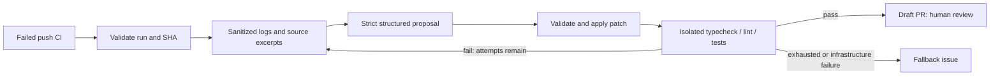

# PatchPilot

A CI-driven repair bot for TypeScript repositories. It watches failed GitHub Actions runs, retrieves relevant source, requests a structured LLM patch, verifies it, and opens a **draft PR for human review**. Unverified repairs become issues, never merges.

This repository is the **bot**, not the Next.js demo. Use it as a Node/TypeScript CLI or a reusable GitHub Action in a separate `patchpilot-demo` repository.

## What Works

- Failed `push` CI on the same repository's default branch is the v1 error source.
- Downloads failed-job logs, extracts file/line locations, and follows relative imports and Next.js `@/` imports.
- Retrieves at most five bounded source/test excerpts. Tests are read-only evidence.
- Uses OpenAI strict JSON-schema output: `{ summary, edits: [{ file, old, new }] }`.
- Applies exact-match edits to existing source files and runs typecheck, lint, and tests.
- Retries with verification feedback, up to three attempts; opens a draft PR only on success.
- Creates a deduplicated fallback issue when repair or infrastructure fails.
- Rejects forks, bot branches, stale commits, oversized patches, symlinks, and edits outside source allowlists.

Runtime-error webhooks, labeled-issue triggers, a dashboard, and a published npm release are not implemented. The package is intentionally private; the Action and local CLI work without publishing to npm.

## Run Locally

Requires Node.js 22+ and git. Offline evaluation needs no credentials or Docker.

```sh
npm ci --ignore-scripts
npm run typecheck
npm run lint
npm test
npm run build
npm run evaluate -- --case null-access
```

The demo first verifies that the seeded code fails, applies a known repair through the real repair loop, and verifies compiler, lint, and test results. This is **oracle mode**, not an AI success-rate claim.

For a real repair, also install/start Docker, add credentials to an ignored `.env` using `.env.example` as the template, then run:

```sh
npm run build
node --env-file=.env dist/cli.js heal 123456789
```

Replace the number with a failed Actions run ID from the target repository. The CLI creates its own disposable checkout at that run's exact SHA; it never edits your working tree. A failure that cannot be reproduced by the three required checks is skipped.

## Use The Action

1. Make this bot repository accessible to the demo repository. For a private Action, enable access under the bot repository's Actions settings.
2. In the demo repository, add the CI and repair workflow templates from [examples/patchpilot-demo-ci.yml](examples/patchpilot-demo-ci.yml) and [examples/patchpilot-demo-heal.yml](examples/patchpilot-demo-heal.yml) under `.github/workflows/`.
3. Replace `YOUR_OWNER/patchpilot@REPLACE_WITH_FULL_COMMIT_SHA` with this repository and an actual reviewed 40-character commit SHA. Do not use a mutable branch for a privileged `workflow_run` bot.
4. Add the demo repository's `OPENAI_API_KEY` Actions secret. Enable **Allow GitHub Actions to create and approve pull requests** in repository Actions settings. PatchPilot does not approve PRs.
5. Ensure the demo uses npm with a committed lockfile and defines the three scripts below. Adjust `main` in the CI template if its default branch differs.
6. Push a small seeded bug to the demo's default branch. The failed `CI` run starts the repair workflow.

The repair job deliberately does **not** check out or execute the failing commit on the privileged host. Only trusted, pinned bot code runs there; target scripts run in Docker.

Required target package scripts:

```json
{
	"scripts": {
		"typecheck": "tsc --noEmit",
		"lint": "eslint .",
		"test": "vitest run"
	}
}
```

Configure tests to run once, not watch mode. The sandbox disables dependency install scripts and networking during checks, so targets needing native build hooks, private registries, external services, or authenticated tests require a separately designed trusted dependency strategy.

**Token permissions:** `actions: read`, `contents: write`, `pull-requests: write`, and `issues: write`, scoped to the target repository. Local fine-grained PATs also need repository metadata read. Default `GITHUB_TOKEN` is sufficient where repository/org policy permits PR creation. Never give the bot administration or merge permissions.

**PR CI caveat:** events generated using `GITHUB_TOKEN` generally do not trigger another workflow. The bot's Docker checks still run, but normal PR CI needs a maintainer-triggered run/update or a narrowly scoped GitHub App token passed as `github-token`. Do not bypass branch protection. Bot-branch runs are ignored by PatchPilot even when a GitHub App triggers CI.

See [docs/demo-app.md](docs/demo-app.md) for the separate Next.js demo contract and a first seeded bug.

## Configuration

| Environment variable | Default | Purpose |
| --- | --- | --- |
| `GITHUB_REPOSITORY` | Set by Actions | Target `owner/repo` |
| `GITHUB_TOKEN` | Required | Target-repository GitHub access |
| `OPENAI_API_KEY` | Required for live runs | OpenAI API access |
| `PATCHPILOT_MODEL` | `gpt-4.1-mini` | Model supporting strict JSON schema |
| `PATCHPILOT_WORKFLOWS` | `CI` | Comma-separated workflow-name allowlist |
| `PATCHPILOT_ALLOWED_PATHS` | `src/` | Comma-separated source directory prefixes |
| `PATCHPILOT_MAX_ATTEMPTS` | `3` | Integer from 1 to 3 |

Action inputs are defined in [action.yml](action.yml). The run ID comes from `workflow_run` or the explicit `run-id` input. Docker uses `node:22-bookworm-slim`; projects must be compatible with Node 22. For a hardened deployment, pin that image to a reviewed digest in the verifier as well as pinning every workflow Action.

## Evaluation

[fixtures/bugs.json](fixtures/bugs.json) contains 12 bugs: type errors, null access, wrong imports, off-by-one indexing, numeric sorting, zero defaults, rounding, missing returns, inverted filtering, missing awaits, optional arrays, and unintended mutation.

```sh
npm run evaluate
npm run evaluate -- --case wrong-import
npm run evaluate -- --live --output evaluation-results-live.json
```

The `--live` run requires `OPENAI_API_KEY` in the shell environment, or invoke `node --env-file=.env --import tsx scripts/evaluate.ts --live`. Live verification uses Docker; the model sees diagnostic evidence but **not** the fixture's known `old`/`new` repair. Each case must fail before attempting any fix. The JSON report records mode, model, cases, attempts, duration, passed checks, and success rate.

| Evaluation | Result |
| --- | --- |
| Offline oracle harness, measured locally | **12/12** verified repairs, one attempt each |
| Real LLM benchmark | **Not measured yet**; needs API access and Docker |
| Unit/integration-contract tests | **17 passing** |

The oracle result proves the retrieval/patch/feedback/verification harness on these fixtures, not model reasoning. The live benchmark exposes test evidence and has no hidden test set; do not present its result as production accuracy. Track live reports across model versions and expand to held-out cases before making broader claims.

To record a real terminal GIF, install [VHS](https://github.com/charmbracelet/vhs) and run `vhs docs/demo.tape`. The tape runs the offline null-access example and writes `docs/demo.gif`; it is not a recording of an LLM or a GitHub PR. No live-run footage or success-rate results are fabricated.

## Architecture



The checkout is a disposable local workspace until verification succeeds. The final patch is published through GitHub's Git Data API as a new commit on `patchpilot/run-<id>`, then a draft PR. No local or remote default-branch changes are made.

## Security And Limits

Read [docs/security.md](docs/security.md) before enabling write permissions. Guardrails reduce risk; they do not prove generated code is correct or eliminate prompt injection. Source, logs, summaries, and generated patches remain untrusted. Human review and branch protection are mandatory.
